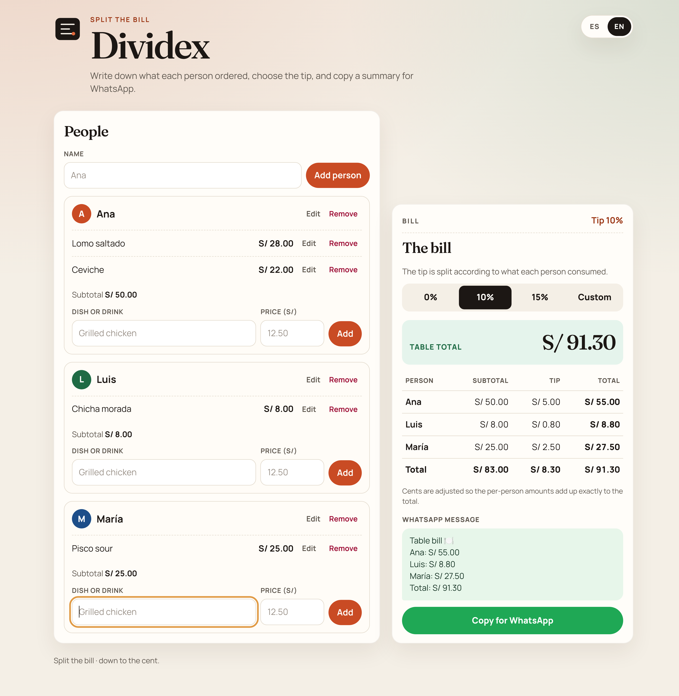
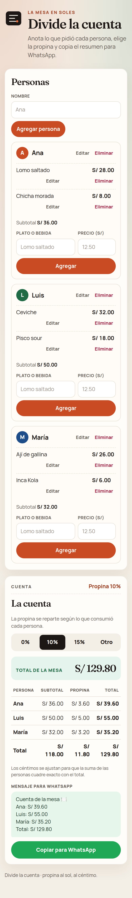
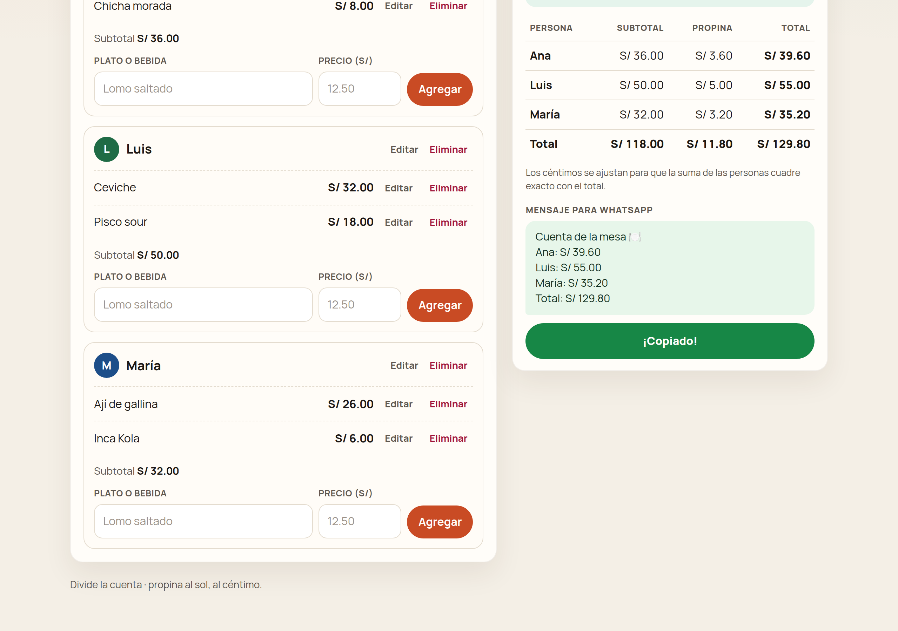
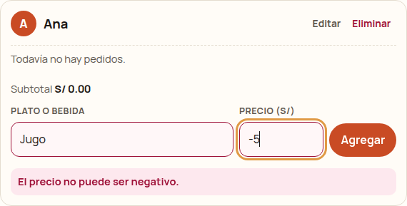

# Dividex

Divide la cuenta

A small static page to split a restaurant bill in Peruvian soles (S/). Built for the MLH Global Hack Week beginner challenge. Open `index.html` in a browser, or use the GitHub Pages site. There is no build step and no server.









## What it does

- Add people and the dishes or drinks they ordered, with a price. Edit or delete people and items.
- Choose a tip: 0%, 10%, 15%, or a custom amount in soles. The tip is split in proportion to what each person consumed.
- See each person's subtotal, tip share, and total, plus the table total. Money is handled in integer cents. Leftover cents use the largest-remainder method (ties keep the list order), so the per-person totals add up to the table total exactly.
- Copy a WhatsApp message. The button confirms with "¡Copiado!" or "Copied!". If the Clipboard API is unavailable, it falls back to a manual copy.
- Switch every label, button, placeholder, validation message, table header, and the WhatsApp text with the **ES / EN** control in the header. The page opens in the browser language (English when that language does not start with `es`) and remembers the choice in this browser.

Amounts are shown as `S/ 12.50` in both languages.

## How to use

1. Open `index.html` in a browser (double-click the file, or drag it onto a browser window).
2. Add each person by name.
3. For each person, add what they ordered and the price. Decimals can use a point or a comma (`12.50` or `12,50`).
4. Pick the tip.
5. Press **Copiar para WhatsApp** and paste the message in the chat.

Empty names are rejected. Empty, zero, and negative prices are rejected and are not added. Each error is explained in the selected language.

Scripts are classic (not ES modules), so the page works from `file://` as well as from GitHub Pages.

## Tests

The split lives in `js/split.js`. From the project folder:

```bash
node test/split.test.js
```

## GitHub Pages

Pushes to `main` run `.github/workflows/pages.yml`. That workflow uses `actions/configure-pages`, `actions/upload-pages-artifact`, and `actions/deploy-pages` to publish the site root (`index.html` and the rest of the static files).

The site is at [https://hallzyx.github.io/dividex/](https://hallzyx.github.io/dividex/).

GitHub Pages for this repository has to use **GitHub Actions** as the source. The workflow does not deploy any other way.

## Español

# Dividex

Divide la cuenta

Página estática para dividir la cuenta de un restaurante en soles (S/). Sirve para el reto de principiantes de MLH Global Hack Week. Abre `index.html` en el navegador o entra al sitio en GitHub Pages. No hace falta compilar ni levantar un servidor.

### Qué hace

- Agrega personas y los platos o bebidas que pidieron, con precio. Puedes editar y eliminar personas y pedidos.
- Elige la propina: 0%, 10%, 15% o un monto en soles. La propina se reparte según lo que consumió cada persona.
- Muestra el subtotal, la parte de la propina y el total de cada persona, además del total de la mesa. El cálculo usa céntimos enteros y reparte los céntimos sobrantes (mayor resto; si hay empate, gana quien aparece primero) para que la suma cuadre exacto.
- Copia un mensaje para WhatsApp. El botón muestra "¡Copiado!" o "Copied!". Si el navegador no deja usar el portapapeles, queda un mensaje para copiarlo a mano.
- El control **ES / EN** del encabezado cambia etiquetas, botones, marcadores de posición, avisos, encabezados de la tabla y el texto de WhatsApp. Al abrir, usa el idioma del navegador (inglés si no empieza por `es`) y guarda la elección en este navegador.

Los montos se ven así en los dos idiomas: `S/ 12.50`.

### Cómo usarla

1. Abre `index.html` en el navegador.
2. Agrega a cada persona por su nombre.
3. Anota lo que pidió y el precio. Puedes usar punto o coma (`12.50` o `12,50`).
4. Elige la propina.
5. Pulsa **Copiar para WhatsApp** y pega el mensaje en el chat.

Un nombre vacío no se acepta. Un precio vacío, cero o negativo no se agrega y muestra un aviso en el idioma elegido.

### Pruebas

```bash
node test/split.test.js
```

### GitHub Pages

Cada push a `main` ejecuta `.github/workflows/pages.yml` (`actions/configure-pages`, `actions/upload-pages-artifact` y `actions/deploy-pages`) y publica la raíz del repositorio.

El sitio queda en [https://hallzyx.github.io/dividex/](https://hallzyx.github.io/dividex/).

En el repositorio, GitHub Pages tiene que usar **GitHub Actions** como origen. El workflow no publica de otra forma.
